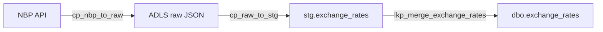
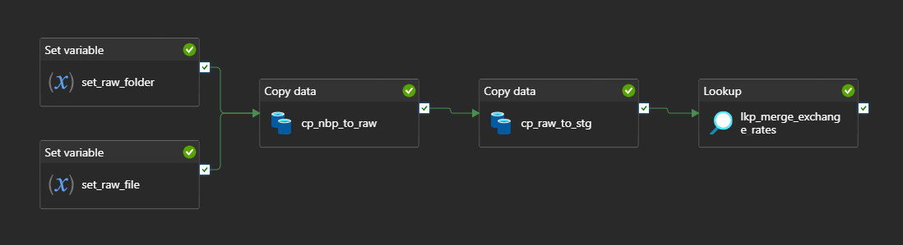
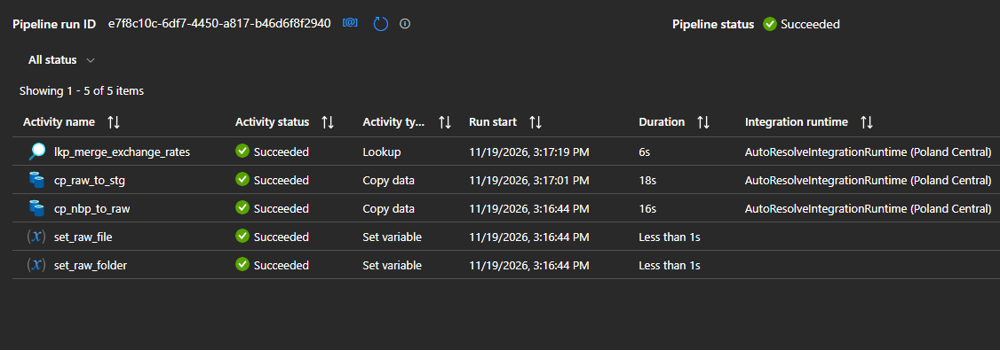
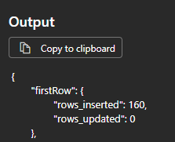
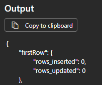

# NBP Exchange Rates - Azure Data Factory pipeline

Pipeline that loads daily NBP exchange rates (table A) into Azure:
NBP API -> ADLS Gen2 (raw JSON) -> Azure SQL Database.

Built to learn Azure Data Factory. Work in progress.

## Flow

## Stack
- Azure Data Factory
- Azure Data Lake Storage Gen2
- Azure SQL Database (serverless)

## Database
- `stg` - staging table with rows from the latest load, truncated before each run
- `dbo` - target table with one rate per date and currency
- `ctl` - watermark and pipeline run log tables (not used by the pipeline yet)

`dbo.usp_merge_exchange_rates` upserts staging rows into the target table.
It stops with an error if staging has incomplete rows or conflicting duplicates,
and returns the number of inserted and updated rows.

`stg.usp_truncate_exchange_rates` truncates the staging table before each load.

## Data Factory
Linked services:
- `ls_http_nbp` - NBP API
- `ls_adls` - ADLS Gen2 storage account (`stnbpdev`)
- `ls_sql` - Azure SQL database (`sqldb-nbp-dev`)

Datasets (parameterized):
- `ds_http_nbp_tables` - NBP table A for a date range (`startDate`, `endDate`)
- `ds_adls_raw_json` - JSON file in the `raw` container (`folderPath`, `fileName`)
- `ds_sql_table` - any table in the database (`schemaName`, `tableName`)

Pipelines:
- `pl_nbp_ingest` - loads one date window, parameters `startDate` and `endDate` (`yyyy-MM-dd`):
   1. `set_raw_folder`, `set_raw_file` - raw file path, computed once per run
   2. `cp_nbp_to_raw` - NBP API -> `raw/nbp/tables_a/load_date=<run date>/nbp_tables_a_<start>_<end>.json`
   3. `cp_raw_to_stg` - truncates staging, flattens `rates` into one row per rate
   4. `lkp_merge_exchange_rates` - runs the merge procedure and reads inserted/updated counts

Naming: `ls_` linked service, `ds_` dataset, `pl_` pipeline,
`set_` / `cp_` / `lkp_` activities (Set variable / Copy / Lookup)
Dataset name = linked service name + what it points to

## Security
The factory connects to storage and SQL with its system-assigned managed identity,
so there are no keys or passwords in the repo.

- Storage: Storage Blob Data Contributor on the `raw` container only.
- SQL: no database roles, only object permissions -
  insert and select on the staging table, execute on the two procedures.
  Select is required by bulk insert (it reads destination table metadata).
  The factory cannot change `dbo` or `ctl` tables directly.
- Staging is truncated through a procedure with `EXECUTE AS OWNER`,
  because `TRUNCATE` needs `ALTER` on the table.

## Setup
1. Fork this repo and create the Azure resources (names are globally unique, so use your own):
   - ADLS Gen2 storage account (hierarchical namespace on) with a `raw` container
   - Azure SQL server with a Microsoft Entra admin and a database
   - Data Factory with Git integration to your fork (root folder `/adf`)
2. Update the storage URL and SQL server/database in `adf/linkedService/`
   and the factory name in `sql/08`, `sql/10` and `tests/test_adf_permissions.sql`.
3. Add your client IP to the SQL server firewall, then run the scripts in `sql/`
   in numeric order while connected with Microsoft Entra authentication.
4. On the SQL server, enable *Allow Azure services and resources to access this server*.
5. On the `raw` container, assign Storage Blob Data Contributor to the factory's managed identity
   (it can take a few minutes to apply).
6. In `ls_adls`, *Test connection -> To linked service* fails by design
   (no account-level access). Use *To file path* with `raw`.
7. Run `pl_nbp_ingest` in Debug with default parameters and compare with Testing.
   Other windows: `yyyy-MM-dd`, up to 93 days (NBP limit), at least one business day
   (a window with no tables returns 404 and fails the run).

## Testing
- `tests/test_usp_merge_exchange_rates.sql` - checks the merge procedure
   (dev only - it truncates the tables).
- `tests/test_adf_permissions.sql` - checks that the factory identity has only
   the permissions it needs and cannot modify target or control tables directly.
- `pl_nbp_ingest` - Debug run for 2026-01-02 - 2026-01-09 loads 160 rows
   (5 tables x 32 currencies). A second run of the same window returns
   0 inserted, 0 updated, and staging still holds 160 rows (truncated before load).

## Design decisions

### Data model
- Three schemas (`stg`, `dbo`, `ctl`) - table role visible from the schema name, the permission test checks `stg.exchange_rates` and every `dbo` / `ctl` table
- Natural key `(effective_date, currency_code)` - one rate per day and currency, short and growing with the date
- Staging without PK, all columns nullable - accepts everything; completeness and uniqueness checked by the merge procedure and the target PK
- `run_id` = ADF `RunId` as log PK - easy join with ADF Monitor
- `source_name` in `ctl` tables - ready for more sources without schema changes

### Types and constraints
- `DECIMAL(18,8)` instead of `FLOAT` - exact rates; 8 decimals because NBP publishes up to 8
- `NVARCHAR` for currency names - Polish characters (e.g. "dolar amerykański")
- `CHAR(3)` for currency codes - ISO 4217 codes are always 3 ASCII letters
- `table_no` as text - structured identifier (`001/A/NBP/2026`), not a number
- `DATETIME2(0)` in UTC - second precision is enough, UTC avoids DST issues
- Named constraints (`PK_`, `DF_`, `CK_`) - readable errors, easier changes
- `CHECK (mid_rate > 0)` and allowed values of `run_status` - basic data quality in the schema

### Merge procedure
- Fail fast - NULLs (`50001`) or conflicting duplicates (`50002`) stop the load instead of saving a wrong rate
- Update only on actual change - idempotent reruns, `updated_at` marks real corrections
- `WITH (HOLDLOCK)` - protects against concurrent merges
- Counts returned with `SELECT` - read by the Lookup activity
- No explicit transaction - a single `MERGE` is atomic, `XACT_ABORT ON` stops on error
- No `EXECUTE AS` - DML works through ownership chaining, elevated rights only where required

### Security
- Managed identity for storage and SQL - no secrets to store, rotate or leak
- Storage Blob Data Contributor on the `raw` container only - data access, not account management (Contributor/Owner); other containers stay inaccessible
- Object permissions instead of `db_datareader` / `db_datawriter` - the factory gets only what the pipeline uses
- `dbo` and `ctl` only through procedures - the only path to the target table goes through validation
- No `ALTER` on procedures - altering one would let the factory run any code with the owner's rights
- `SELECT` only on the staging table - required by bulk insert to read table metadata
- `TRUNCATE` through a procedure with `EXECUTE AS OWNER` - SQL Server has no `TRUNCATE` permission (minimum is `ALTER`) and ownership chaining does not cover DDL
- Grants as numbered migrations - permission history in the repo

### Permission test
- `EXECUTE AS USER` + `HAS_PERMS_BY_NAME` - checks effective permissions without changing data
- Positive and negative checks - required permissions = 1, everything else = 0 (regression test against quick fixes)
- Table and procedure lists read before `EXECUTE AS` - otherwise hidden objects would make the test pass on empty lists
- NULL = error, no rows = the test did not run

### Network and connections
- *Allow Azure services* on the SQL server - Azure IR has no fixed IP; it lets in traffic from any Azure subscription, but authentication is still required
- Firewall rules for single client IPs, not ranges - a provider's range would expose the server to unrelated users; stale rules removed
- Encrypt: Mandatory with certificate validation - full session encryption; Strict (TDS 8.0) also encrypts pre-login, but not all clients support it
- Daily access with Entra MFA, SQL login only as an emergency account

### Data Factory
- HTTP connector, not REST connector - equivalent for this API; REST connector helps with pagination and OAuth, not used by NBP
- Parameterized datasets, one per connection type - dates, paths and tables passed at run time
- Import schema: None on datasets - a stored schema fits one table or file and goes stale; mapping lives in the Copy activity
- Raw layer instead of API -> SQL directly - data can be reloaded from files after a fix, without calling the API; shows what NBP returned on load day
- Raw file path computed once per run from `pipeline().TriggerTime` - both copy activities use the same path, even if the run crosses midnight
- File name built from the date window - rerun of the same window overwrites the file, different windows loaded on the same day get separate files
- Raw stored as JSON, not Binary - same content, formatting may differ; invalid response fails before saving; one dataset less (but Binary would keep exact bytes)
- Raw file as array of objects, not set of objects (JSON Lines) - same shape as the API response, one valid JSON document; line-by-line reading not needed at this size
- JSON flattened with collection reference on `rates` - no OPENJSON or `NVARCHAR(MAX)` column needed
- Merge run with Lookup, not Stored procedure activity - only Lookup returns the procedure result
- Feature branches + PR to `main`, Publish from `main` only - the live factory runs only merged code; Debug runs from the branch

### Naming
- No environment in ADF object names - same JSON in dev and prod
- Dataset name = linked service name + target - shows which connection a dataset uses
- Azure resources: Cloud Adoption Framework abbreviations, `type-project-environment`

### Scripts
- Idempotent scripts - `IF ... IS NULL`, `IF NOT EXISTS`, `CREATE OR ALTER` (keeps permissions)
- Numbered scripts, structure changes as new files, procedures edited in place
- One file = one batch, no `GO` - each procedure in its own file (`CREATE PROCEDURE` must be the first statement in a batch)

## Known trade-offs
- Factory and resource names hardcoded in linked services and scripts - fix: ARM template parameters per environment, Bicep, sqlcmd variables
- SQL and storage reachable over public endpoints (cost) - fix: Managed VNet + Private Endpoint
- One staging table per source - runs must not overlap, a parallel run would truncate another run's staging - fix: pipeline concurrency = 1 or `run_id` column in staging
- Tests checked visually, nothing fails automatically - fix: `check | expected | actual` rows + `THROW` on mismatch, then run in CI

## Status
- [x] Azure resources
- [x] SQL schema and merge procedure
- [x] Linked services, datasets and permissions
- [x] Ingestion pipeline
- [ ] Incremental load + scheduling
- [ ] Logging and error handling